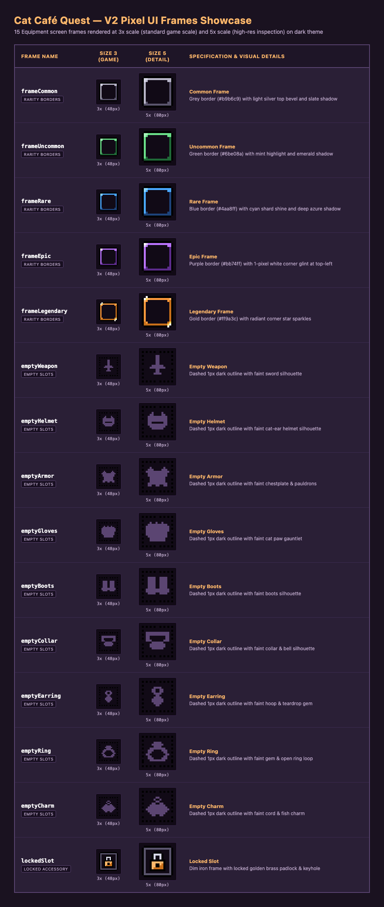
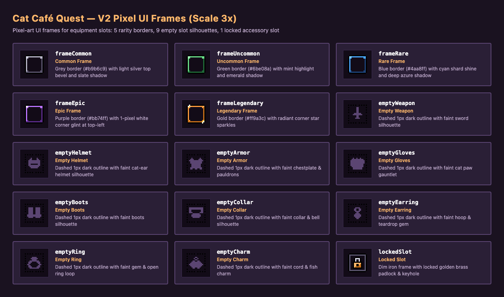
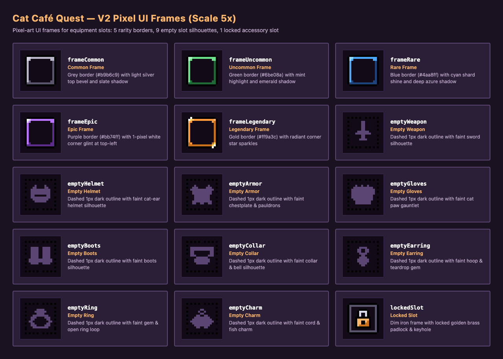

# V2 Pixel UI Frames Report (v25b-frames)

## Overview

This report documents the implementation and verification of the pixel-art UI equipment frames for **Cat Café Quest v2** (`apps/web/src/art/v2Frames.tsx` and `apps/web/src/art/v2Frames.test.tsx`). The frames follow the engine architecture established in `apps/web/src/art/pixelIcons.tsx`, utilizing single-character-per-pixel string maps, CSS theme variables with exact hex fallbacks, and 1-pixel dark outlines for crisp presentation at 3x scale (standard game resolution) and 5x scale (high-resolution detail inspection).

All frames are strictly 16 × 16 pixel squares. Rarity border frames feature a fully transparent 8 × 8 (and up to 12 × 12) inner cutout to accommodate equipped item icons without obstruction. Empty slot frames feature an alternating 1-pixel dark dashed perimeter with a faint silhouette hint (`var(--border, #5b4572)`), and the locked accessory slot features a dim iron frame bearing a locked golden brass padlock with keyhole.

---

## Frame List & Design Specifications

| Category | Frame Identifier | Dimensions | Visual Description | Palette Tokens |
| :--- | :--- | :--- | :--- | :--- |
| **Rarity Border** | `frameCommon` | 16 × 16 px | Clean grey border (`#b9b6c9`) with silver light bevel on top-left and dark slate shadow on bottom-right | `k`, `c`, `x`, `z` |
| **Rarity Border** | `frameUncommon` | 16 × 16 px | Vibrant green border (`#6be08a`) with pale mint highlight and deep emerald shadow | `k`, `u`, `e`, `n` |
| **Rarity Border** | `frameRare` | 16 × 16 px | Luminous azure blue border (`#4aa8ff`) with cyan magic shard shine and deep navy shadow | `k`, `r`, `s`, `b` |
| **Rarity Border** | `frameEpic` | 16 × 16 px | Violet purple border (`#bb74ff`) with a 1-pixel specular white corner glint at top-left and deep violet shadow | `k`, `p`, `j`, `i`, `w` |
| **Rarity Border** | `frameLegendary` | 16 × 16 px | Radiant gold border (`#ff9a3c`) adorned with glowing diamond corner star sparkles (`#ffffff` & `#ffd75e`) | `k`, `o`, `g`, `y`, `d`, `w` |
| **Empty Slot** | `emptyWeapon` | 16 × 16 px | Dashed 1px dark perimeter framing a faint watermark silhouette of an upright knight sword | `k`, `f` |
| **Empty Slot** | `emptyHelmet` | 16 × 16 px | Dashed 1px dark perimeter framing a faint watermark silhouette of a cat-eared knight helmet with visor slit | `k`, `f` |
| **Empty Slot** | `emptyArmor` | 16 × 16 px | Dashed 1px dark perimeter framing a faint watermark silhouette of a chestplate with pauldrons and split skirt | `k`, `f` |
| **Empty Slot** | `emptyGloves` | 16 × 16 px | Dashed 1px dark perimeter framing a faint watermark silhouette of a cat paw mitten gauntlet with toe lobes and thumb | `k`, `f` |
| **Empty Slot** | `emptyBoots` | 16 × 16 px | Dashed 1px dark perimeter framing a faint watermark silhouette of a pair of adventurer boots with soles and heels | `k`, `f` |
| **Empty Slot** | `emptyCollar` | 16 × 16 px | Dashed 1px dark perimeter framing a faint watermark silhouette of a curved cat collar suspending a round jingle bell | `k`, `f` |
| **Empty Slot** | `emptyEarring` | 16 × 16 px | Dashed 1px dark perimeter framing a faint watermark silhouette of an ear hoop suspending a faceted teardrop gem | `k`, `f` |
| **Empty Slot** | `emptyRing` | 16 × 16 px | Dashed 1px dark perimeter framing a faint watermark silhouette of a prong-set gemstone on an open circular ring band | `k`, `f` |
| **Empty Slot** | `emptyCharm` | 16 × 16 px | Dashed 1px dark perimeter framing a faint watermark silhouette of a cord loop suspending a cat fish amulet pendant | `k`, `f` |
| **Locked Slot** | `lockedSlot` | 16 × 16 px | Heavy locked brass padlock with metallic shackle and dark keyhole set within a dim iron frame | `k`, `z`, `x`, `g`, `d` |

---

## Palette and CSS Theme Variable Mapping

Colors map directly to the design specification and tokens defined in `apps/web/src/theme.css`:

| Char | Hex / CSS Variable Fallback | Semantic Role |
| :---: | :--- | :--- |
| `k` | `#000000` | 1-pixel dark outline, dashed slot border, keyhole |
| `w` | `#ffffff` | Pure white specular glint (Epic) and sparkle core (Legendary) |
| `c` | `var(--rarity-common, #b9b6c9)` | Common item rarity border (grey) |
| `x` | `#d8d8e8` | Common metallic highlight / padlock shackle highlight |
| `z` | `#5a556d` | Common dark slate shadow / dim frame / padlock shackle shadow |
| `u` | `var(--good, #6be08a)` | Uncommon item rarity border (green) |
| `e` | `#a8f5bc` | Uncommon mint green bevel highlight |
| `n` | `#1f6937` | Uncommon deep forest emerald shadow |
| `r` | `var(--rarity-rare, #4aa8ff)` | Rare item rarity border (azure blue) |
| `s` | `var(--shard, #8fd8ff)` | Rare cyan magic shard specular shine |
| `b` | `#1d437a` | Rare dark blue bevel shadow |
| `p` | `var(--rarity-epic, #bb74ff)` | Epic item rarity border (violet purple) |
| `j` | `#e5ccff` | Epic pale lilac bevel highlight |
| `i` | `#5c2b8c` | Epic deep violet shadow |
| `o` | `var(--rarity-legendary, #ff9a3c)` | Legendary item rarity border (gold/orange) |
| `g` | `var(--gold, #ffd34e)` | Bright gold accent / padlock body face |
| `y` | `var(--focus, #ffd75e)` | Pale warm yellow sparkle rays / gold highlight |
| `d` | `#c9701a` | Dark amber shadow / padlock body shadow |
| `f` | `var(--border, #5b4572)` | Empty slot silhouette watermark hint |
| `h` | `var(--surface-2, #3a2c4a)` | Silhouette depth / interior shading |

---

## Screenshot Sheets

Screenshots captured on dark background (`#1a1220`) using Playwright Chromium:

### 1. Complete Frame Showcase & Specifications (Comparison Sheet)
- **File:** `reports/v25b-frames/v2-frames-all.png`



### 2. Standard Game Display Scale (Size 3x)
- **File:** `reports/v25b-frames/v2-frames-size-3.png`



### 3. High-Resolution Detail Scale (Size 5x)
- **File:** `reports/v25b-frames/v2-frames-size-5.png`



---

## Test Verification

The test suite in `apps/web/src/art/v2Frames.test.tsx` includes 54 automated unit tests verifying:
1. **Registry completeness**: All 15 frame identifiers exported in `V2_FRAME_NAMES`.
2. **Dimension and geometry constraints**: Every frame is 16 × 16 square (within 14–16 px required), every row has matching length, and only palette characters or transparent `.` are used.
3. **Transparent center guarantee**: Every frame named `frame*` has a 100% transparent 8 × 8 center (zero pixels in rows 4..11 and cols 4..11).
4. **Accessible SVG markup**:
   - Decorative when `title` is absent (`aria-hidden="true"`, no `role`, no `<title>`).
   - Accessible when `title` is present (`role="img"`, `aria-label={title}`, `<title>{title}</title>`, no `aria-hidden`).
5. **Dynamic scaling**: Correct width and height scaling at size 3 and size 5 with `shapeRendering="crispEdges"`.
6. **Theme token alignment**: Exact theme variables and fallback hex codes match the game design plan.
7. **Corner glints & sparkles**:
   - `frameEpic`: Exactly one pixel of specular white (`w`) in the top-left corner.
   - `frameLegendary`: Multi-pixel star sparkles positioned in the corners outside the center block.

---

## Exact Commands and Output

### 1. Git User Configuration Check
```bash
$ git config user.email && git config user.name
108352255+ntbaoheyhey@users.noreply.github.com
ntbaoheyhey
```

### 2. Package Installation (`--frozen-lockfile`)
```bash
$ pnpm install --frozen-lockfile
Scope: all 7 workspace projects
Lockfile is up to date, resolution step is skipped
Already up to date
╭ Warning ─────────────────────────────────────────────────────────────────────╮
│                                                                              │
│   Ignored build scripts: bufferutil@4.1.0, keccak@3.0.4,                     │
│   utf-8-validate@5.0.10.                                                     │
│   Run "pnpm approve-builds" to pick which dependencies should be allowed     │
│   to run scripts.                                                            │
│                                                                              │
╰──────────────────────────────────────────────────────────────────────────────╯
Done in 455ms using pnpm v10.28.0
```

### 3. Unit Tests (`@taskbar-hero/web`)
```bash
$ pnpm --filter @taskbar-hero/web test

> @taskbar-hero/web@0.0.0 test /Users/bao/taskbar-hero/apps/web
> vitest run


 RUN  v5.0.5 /Users/bao/taskbar-hero/apps/web

 ✓ src/art/v2Frames.test.tsx (54 tests) 355ms
 ✓ src/CafeBoard.test.tsx (5 tests) 398ms
 ✓ src/onboarding/HowToPlay.test.tsx (14 tests) 442ms
 ✓ src/game/errorStates.test.tsx (11 tests) 429ms
 ✓ src/market/MarketTab.test.tsx (17 tests) 536ms
 ✓ src/forge/ForgeTab.test.tsx (18 tests) 759ms
 ✓ src/boss/BossTab.test.tsx (10 tests) 669ms
 ✓ src/App.test.tsx (3 tests) 756ms
 ✓ src/inventory/InventoryTab.test.tsx (12 tests) 1302ms
 ✓ src/wallet/wallet.test.tsx (7 tests) 404ms
 ✓ src/game/gameState.test.ts (5 tests) 112ms
 ✓ src/game/apiSwitch.test.ts (5 tests) 123ms
 ✓ src/layout/StageLayout.test.tsx (5 tests) 757ms
 ✓ src/art/pixelIcons.test.tsx (18 tests) 193ms
 ✓ src/forge/ForgeReveal.test.tsx (3 tests) 161ms
 ✓ src/game/Hud.test.tsx (4 tests) 91ms
 ✓ src/game/store.test.tsx (3 tests) 58ms
 ✓ src/HeroTab.test.tsx (1 test) 85ms
 ✓ src/motion/useTickNumber.test.ts (8 tests) 46ms
 ✓ src/theme/labels.test.ts (3 tests) 16ms
 ✓ src/motion/reducedMotion.test.ts (5 tests) 17ms
 ✓ src/api/SupabaseGameApi.test.ts (7 tests) 8ms
 ✓ src/market/relicMetadata.test.ts (12 tests) 5ms
 ✓ src/api/MockGameApi.test.ts (12 tests) 11ms
 ✓ src/layout/metrics.test.ts (6 tests) 2ms
 ✓ src/onboarding/nextStep.test.ts (5 tests) 3ms

 Test Files  26 passed (26)
      Tests  253 passed (253)
   Start at  19:38:30
   Duration  3.62s (environment 56%, tests 25%, import 16%, transform 3%)
```

### 4. Workspace Typecheck
```bash
$ pnpm typecheck

> taskbar-hero@0.0.0 typecheck /Users/bao/taskbar-hero
> pnpm -r typecheck

Scope: 6 of 7 workspace projects
packages/auth typecheck$ tsc --noEmit
└─ Running...
packages/chain typecheck$ tsc --noEmit
└─ Running...
supabase/tests typecheck$ tsc --noEmit
└─ Running...
packages/game-rules typecheck$ tsc --noEmit
└─ Running...
└─ Done in 528ms
└─ Done in 1.1s
└─ Done in 1.4s
└─ Done in 2s
packages/api-contract typecheck$ tsc --noEmit
└─ Running...
└─ Done in 404ms
apps/web typecheck$ tsc --noEmit
└─ Running...
└─ Done in 2.8s
```

### 5. Workspace Lint
```bash
$ pnpm lint

> taskbar-hero@0.0.0 lint /Users/bao/taskbar-hero
> pnpm -r lint

Scope: 6 of 7 workspace projects
packages/auth lint$ tsc --noEmit
└─ Running...
packages/chain lint$ tsc --noEmit
└─ Running...
packages/game-rules lint$ tsc --noEmit
└─ Running...
supabase/tests lint$ tsc --noEmit
└─ Running...
└─ Done in 429ms
└─ Done in 652ms
└─ Done in 876ms
└─ Done in 1.3s
packages/api-contract lint$ tsc --noEmit
└─ Running...
└─ Done in 369ms
apps/web lint$ tsc --noEmit
└─ Running...
└─ Done in 3s
```

### 6. Workspace Build
```bash
$ pnpm build

> taskbar-hero@0.0.0 build /Users/bao/taskbar-hero
> pnpm -r build

Scope: 6 of 7 workspace projects
packages/auth build$ tsc --noEmit
└─ Running...
packages/chain build$ tsc --noEmit
└─ Running...
packages/game-rules build$ tsc --noEmit
└─ Running...
supabase/tests build$ tsc --noEmit
└─ Running...
└─ Done in 475ms
└─ Done in 760ms
└─ Done in 944ms
└─ Done in 1.4s
packages/api-contract build$ tsc --noEmit
└─ Running...
└─ Done in 372ms
apps/web build$ tsc --noEmit && vite build
└─ Running...
│ vite v8.3.5 building client environment for production...
└─ Running...
│ transforming...
└─ Running...
│ [plugin rolldown:vite-resolve] Module "node:worker_threads" has been externalized for browser compatibility, imported by "packages/auth/node_modules/jose/dist/node/esm/runtime/sign.js".
└─ Running...
│ ✓ 1679 modules transformed.
└─ Running...
│ rendering chunks...
└─ Running...
│ computing gzip size...
└─ Running...
│ dist/index.html                               2.05 kB │ gzip:   0.75 kB
│ dist/assets/index-djZZZ0we.css               34.77 kB │ gzip:   7.28 kB
│ dist/assets/rolldown-runtime-XKyaHtl9.js      0.72 kB │ gzip:   0.42 kB
│ dist/assets/createGame-CYG5tCgZ.js            8.45 kB │ gzip:   3.48 kB
│ dist/assets/index-BID6FgKF.js                95.06 kB │ gzip:  27.88 kB
│ dist/assets/react-KPuNr9iS.js               218.74 kB │ gzip:  68.27 kB
│ dist/assets/web3-BKxr0A5j.js                363.83 kB │ gzip: 108.14 kB
│ dist/assets/phaser-CS_hOpYn.js            1,194.43 kB │ gzip: 318.49 kB
│ ✓ built in 343ms
└─ Done in 3.3s
```

---

## Design Decisions & Notes

1. **Uniform 16 × 16 Pixel Dimensions**:
   - The specification permitted frame sizes between 14 and 16 px square.
   - Sizing all 15 frames uniformly to 16 × 16 ensures every slot in the equipment grid aligns into identical cell bounding boxes (`48 × 48 px` at 3x scale, `80 × 80 px` at 5x scale).
   - This generous dimension allows an unobstructed transparent center opening of 10 × 10 to 12 × 12 pixels, easily fitting 8–12 px item icons without overlapping the rarity border bevels.

2. **Dashed Perimeter for Empty Slots**:
   - The dashed outline pattern uses symmetric 1-pixel alternating dashes (`k.k.k.k..k.k.k.k` horizontally and vertically), anchoring each corner with solid outline pixels while maintaining clear gaps that signal an empty receptacle.
   - The watermark silhouette in the interior uses `var(--border, #5b4572)`, giving a subtle hint of the slot item on the dark background (`#1a1220`) that does not distract from equipped items.

3. **Padlock Design for `lockedSlot`**:
   - For accessory slots unlocked at higher levels (Earring at Lv 5, Ring at Lv 10, Charm at Lv 20), `lockedSlot` renders an arched silver/slate shackle entering a brass lock body with a dark keyhole.
   - It is framed in a dim iron border (`#5a556d`), providing instant visual contrast against empty or unlocked slots.

4. **Zero Mod-Bleed & Clean Worktree**:
   - Only the specified files (`apps/web/src/art/v2Frames.tsx`, `apps/web/src/art/v2Frames.test.tsx`, `reports/v25b-frames.md`, and `reports/v25b-frames/*.png`) were created or edited.
   - All screenshot rendering scripts were run from a non-committed scratch directory and removed from the Git worktree.
