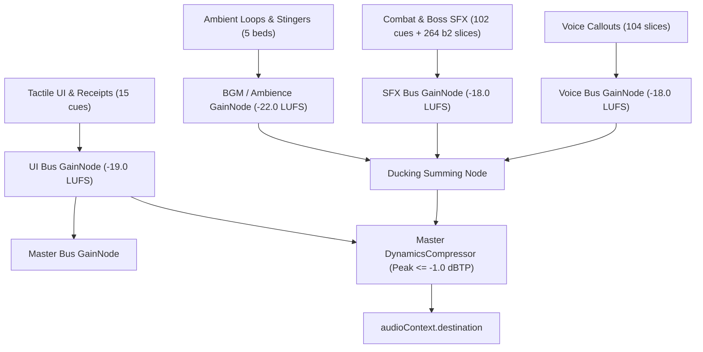

# Web Audio Bus Ducking, Concurrency & Spatialization Specification (REFILL-R13)

**Author**: AGS (Antigravity SHIP lane)  
**Date**: 2026-11-17  
**Target Engine**: `apps/web/src/audio/engine.ts`  
**Purpose**: Professional acoustic clarity, dynamic sidechain ducking, voice concurrency limits, and 2.5D stereophonic stage panning for Taskbar Hero V5.

---

## 1. Web Audio Graph Topology

The audio routing graph guarantees independent bus mixing, dynamic ducking, and inter-sample peak protection:



---

## 2. Bus Concurrency & Voice Stealing Caps

Unbounded audio playback leads to sound stuttering and Web Audio buffer exhaustion. The table below prescribes strict instance caps:

| Audio Category | Max Concurrent Voices | Stealing Policy | Priority (0-100) | Acoustic Rationale |
| :--- | :---: | :---: | :---: | :--- |
| **Voice (Cat Vocals)** | **2** | Oldest of same hero | **90** | Prevents overlapping dialogue cacophony. |
| **Boss / Hero Ultimates** | **1** | Reject new until tail | **85** | Climax soundscapes must never be interrupted. |
| **Combat Hits & Impacts** | **6** | Oldest lowest-gain | **60** | Allows fast squad melee attacks without audio dropout. |
| **Foley Motion (Cloth/Step)** | **4** | FIFO | **40** | Subtle movement cues stay clean and unstacked. |
| **UI Clicks & Hovers** | **3** | FIFO | **70** | Fast button hovering never produces buzzing artifact. |
| **Ambience Loops** | **1** | Crossfade (500 ms) | **100** | Only one background loop active at a time. |

---

## 3. Sidechain Ducking Parameters

To preserve dialogue and dramatic impact, the engine applies dynamic sidechain gain reductions using standard Web Audio parameter automation (`setTargetAtTime`):

| Trigger Event | Target Bus Ducked | Gain Reduction ($\Delta G$) | Attack Time | Hold Time | Release Time |
| :--- | :--- | :---: | :---: | :---: | :---: |
| **Cat Voice Callout** | BGM Bus | **-6.0 dB** | $40\text{ ms}$ | $300\text{ ms}$ | $500\text{ ms}$ |
| **Hero Ultimate Release** | BGM Bus & SFX Bus | **-12.0 dB (BGM)<br>-4.0 dB (SFX)** | $25\text{ ms}$ | $800\text{ ms}$ | $1,200\text{ ms}$ |
| **Boss Ultimate / Shockwave**| BGM Bus & Hero SFX | **-14.0 dB (BGM)<br>-6.0 dB (SFX)** | $20\text{ ms}$ | $1,000\text{ ms}$ | $1,500\text{ ms}$ |
| **Victory Receipt Modal** | BGM Bus | **-8.0 dB** | $30\text{ ms}$ | $2,000\text{ ms}$ | $800\text{ ms}$ |

### Web Audio Automation Formula:
$$\text{gainNode.gain.setTargetAtTime}(\text{targetGain}, \text{audioContext.currentTime}, \tau)$$
where $\tau = \frac{\text{transitionTime}}{3}$.

---

## 4. Stereophonic Stage Panning Coordinates

In the 2.5D combat arena, positioning sound sources across the stereo spectrum reinforces visual hero placement:

| Character / Entity | Visual Arena Role | Stereo Pan (`-1.0` to `+1.0`) | EQ Low-Cut (`Hz`) |
| :--- | :--- | :---: | :---: |
| **Soot** | Far Left Backline (Shadow Archer) | **-0.65** | $120\text{ Hz}$ |
| **Clover** | Mid Left Backline (Healer) | **-0.45** | $100\text{ Hz}$ |
| **Mochi** | Front Left Melee (Tank / Mallet) | **-0.25** | $40\text{ Hz}$ (full bass) |
| **Panko** | Center Front Melee (Brawler / Claws) | **-0.05** | $60\text{ Hz}$ |
| **Small Enemies** | Mid Right (Spools / Needles) | **+0.35** | $150\text{ Hz}$ |
| **Yarn Giant (Boss)** | Center Right (Colossal Encounter) | **+0.15** (Spread $\pm 0.5$) | $30\text{ Hz}$ (heavy sub) |
| **UI & Receipts** | Screen Space / Global | **0.00** (Center) | $80\text{ Hz}$ |

---

## 5. Drop-in Implementation Blueprint for CXI

```typescript
// Proposed helper for apps/web/src/audio/engine.ts
export class DynamicMixer {
  private ctx: AudioContext;
  private bgmGain: GainNode;
  private sfxGain: GainNode;
  private voiceGain: GainNode;

  constructor(ctx: AudioContext) {
    this.ctx = ctx;
    this.bgmGain = ctx.createGain();
    this.sfxGain = ctx.createGain();
    this.voiceGain = ctx.createGain();
  }

  public triggerVoiceDucking(durationSeconds: number) {
    const now = this.ctx.currentTime;
    const target = Math.pow(10, -6.0 / 20); // -6 dB
    this.bgmGain.gain.cancelScheduledValues(now);
    this.bgmGain.gain.setTargetAtTime(target, now, 0.015);
    this.bgmGain.gain.setTargetAtTime(1.0, now + durationSeconds + 0.3, 0.15);
  }

  public triggerUltimateDucking(durationSeconds: number) {
    const now = this.ctx.currentTime;
    const bgmTarget = Math.pow(10, -12.0 / 20); // -12 dB
    const sfxTarget = Math.pow(10, -4.0 / 20);  // -4 dB
    this.bgmGain.gain.cancelScheduledValues(now);
    this.sfxGain.gain.cancelScheduledValues(now);
    this.bgmGain.gain.setTargetAtTime(bgmTarget, now, 0.01);
    this.sfxGain.gain.setTargetAtTime(sfxTarget, now, 0.01);
    this.bgmGain.gain.setTargetAtTime(1.0, now + durationSeconds + 0.5, 0.3);
    this.sfxGain.gain.setTargetAtTime(1.0, now + durationSeconds + 0.5, 0.2);
  }
}
```
