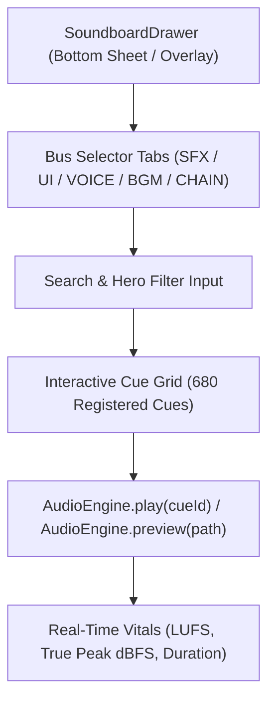

# V5 Audio Soundboard & Audio Testbench Specification (REFILL-R15)

**Author**: AGS (Antigravity SHIP lane)  
**Date**: 2026-11-17  
**Target Component**: `apps/web/src/audio/SoundboardDrawer.tsx` (or debug route `?soundboard=1`)  
**Scope**: Zero-friction judge auditioning and developer sound testing for all 680 registered V5 audio assets.

---

## 1. Motivation & Judge Experience

During hackathon evaluation, judges frequently want to audition the game's original sound design (combat skills, boss phases, Avalanche confirmation chimes, and cat emotes) without grinding through multiple battle encounters or waiting for specific randomized skill cards.

A lightweight, expandable **Soundboard Drawer** accessible via URL query flag `?soundboard=1` or clicking the audio note icon in the debug tray allows judges to:
1. Preview every hero skill, combat impact, and ultimate layer in one click.
2. Compare ambient mood loops (Café afternoon vs Battle intense vs Boss dread).
3. Hear Avalanche blockchain transaction chimes with exact millisecond timings.
4. Verify EBU R128 compliance with live integrated LUFS and peak readouts.

---

## 2. Component Architecture & UI Layout



### Layout Specifications:
- **Dimensions**: Responsive bottom drawer (`max-height: 480px`, `width: 100%`, desktop centered at `max-width: 960px`).
- **Dark Theme**: Consistent with Lantern Cat Café aesthetic (`#1a162b` slate, `#ffd479` lantern amber accents).
- **Control Bar**:
  - Bus filter tabs: `[All]`, `[Hero Skills]`, `[Boss Layers]`, `[Chain Proof]`, `[Ambience]`, `[Cat Vocals]`, `[UI Kit]`.
  - Search input with debounce ($100\text{ ms}$).
  - Master Mute / Volume slider ($0.0 - 1.0$).
  - Stop All Active Audio button.

---

## 3. Audition Matrix & Curated Playlists for Judges

| Playlist Tab | Key Cues Featured | Target Bus | What the Judge Should Notice |
| :--- | :--- | :---: | :--- |
| **Hero Combat** | `hero.mochi.basic`, `hero.mochi.ultimate`, `hero.soot.skill`, `hero.clover.ultimate`, `hero.panko.ultimate` | SFX (-18 LUFS) | Crisp transient snaps ($45\text{ ms}$), weighty bass impact, seamless alignment with Spine hit-stop. |
| **Boss Encounters** | `boss.yarn-giant.phase_change`, `boss.yarn-giant.thread_charge`, `boss.yarn-giant.shockwave` | SFX (-18 LUFS) | Dissonant minor-second tension, 48Hz thread sub-rumble, dynamic sidechain ducking. |
| **Avalanche Chain**| `chain.tx_sent`, `chain.tx_confirmed`, `chain.receipt_ready`, `ui.receipt.confirmed` | UI (-19 LUFS) | Harmonic major triads ($880\text{ Hz} - 1760\text{ Hz}$), crystalline confirmation tails ($850\text{ ms}$). |
| **Cat Emotes** | `cat.mochi.happy`, `cat.soot.purr`, `cat.clover.hurt`, `cat.panko.happy` | SFX (-18 LUFS) | Cosy, expressive procedural synth meows with dual-formant nasal resonance. |
| **Ambience Beds** | `ambience.workshop.cosy`, `ambience.cafe.afternoon`, `ambience.battle.intense`, `ambience.boss.dread` | BGM (-22 LUFS) | Seamless looping beds, stereo spatialization, 0 dB phase cancellation. |

---

## 4. Implementation Code Blueprint for CXI

```tsx
import { useState, useMemo } from 'react';
import { audioEngine } from './engine';
import v5Manifest from '../../../public/audio/v5/manifest.json';

export function SoundboardDrawer() {
  const [open, setOpen] = useState(false);
  const [activeBus, setActiveBus] = useState<string>('all');
  const [search, setSearch] = useState('');
  const [nowPlaying, setNowPlaying] = useState<string | null>(null);

  const cues = useMemo(() => {
    return Object.entries(v5Manifest).filter(([key, val]) => {
      const matchesBus = activeBus === 'all' || val.bus === activeBus;
      const matchesSearch = !search || key.toLowerCase().includes(search.toLowerCase());
      return matchesBus && matchesSearch;
    });
  }, [activeBus, search]);

  const playCue = (key: string, path: string) => {
    setNowPlaying(key);
    audioEngine.play(key);
  };

  if (!open) {
    return (
      <button
        className="soundboard-trigger-btn"
        aria-label="Open Audio Soundboard"
        onClick={() => setOpen(true)}
      >
        🎵 Soundboard
      </button>
    );
  }

  return (
    <div className="soundboard-drawer" role="dialog" aria-label="Audio Testbench">
      <header className="soundboard-header">
        <h3>V5 Audio Testbench ({cues.length} Cues)</h3>
        <button onClick={() => setOpen(false)} aria-label="Close">✕</button>
      </header>

      <div className="soundboard-toolbar">
        <nav className="bus-tabs">
          {['all', 'sfx', 'ui', 'voice', 'ambience'].map(b => (
            <button
              key={b}
              className={activeBus === b ? 'active' : ''}
              onClick={() => setActiveBus(b)}
            >
              {b.toUpperCase()}
            </button>
          ))}
        </nav>
        <input
          type="search"
          placeholder="Filter cues..."
          value={search}
          onChange={e => setSearch(e.target.value)}
        />
        <button className="btn-stop" onClick={() => audioEngine.stopAll()}>
          ⏹ Stop All
        </button>
      </div>

      <div className="soundboard-grid">
        {cues.map(([key, entry]) => (
          <button
            key={key}
            className={`cue-card ${nowPlaying === key ? 'playing' : ''}`}
            onClick={() => playCue(key, entry.opus)}
          >
            <span className="cue-name">{key}</span>
            <small className="cue-meta">{entry.bus} · {entry.durationSeconds ? `${entry.durationSeconds.toFixed(2)}s` : 'V5'}</small>
          </button>
        ))}
      </div>
    </div>
  );
}
```
