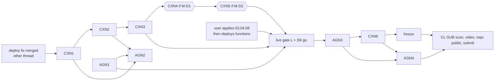

# Wave N: every remaining Codex and Antigravity mission, in paste order (written 31 Oct 2026)

This is the only queue from now to submission. It replaces the Codex/Antigravity rows of
`wave-s/plan.md` sections 12-14 (that text is not edited; rows done there stay done). Claude
verifies and merges each report; the user pastes the next prompt on a tool the moment the previous
one on that tool has pushed its report AND its "Needs" line is true. Never two missions at once on
one tool.

## 0. Where main is (31 Oct, commit 322e999)

Merged: C1 guards (#208), C2 voucher security tests (#209), C3 rehearsal (#210), M2 mechanics (#207),
C8 block reasons in UI (#211), C4 prod refuses mock sign-in (#212), C5 siwe_nonces policy (#213),
AGM3 Fuji proof (#214), C6 per-player request budgets (#215), C7 = U-4 fix 1 cancelled-voucher
re-issue (#216).

Open problems:
- Edge Function deploy fails: `Module not found .../packages/api-contract/src/v2` (the Deno import
  map in each `supabase/functions/*/deno.json` has no entry for the new `api-contract/src/v2`
  file). Another thread is fixing it. **CXN1 starts only after that fix is merged.**
- Three migrations are on main but NOT applied live: `20261103000000_siwe_nonces_server_only.sql`,
  `20261104000000_v2_request_budgets.sql`, `20261106000000_voucher_cancel_reissue.sql`. The v2
  limiter fails closed (HTTP 503 on every v2 route) if the functions deploy before 20261104 is
  applied. Order: apply 03, 04, 06 in the SQL editor, THEN deploy functions.

## 1. Paste queue

| # | Codex (one at a time) | Needs | Antigravity (one at a time) | Needs |
|---|---|---|---|---|
| 1 | **CXN1** Relic recovery: claim id, never-hidden pending voucher, re-issue race guard | deploy-fix PR merged | **AGN1** Clear error screens: 429 wait, 503 busy, offline, wrong wallet | nothing, paste now |
| 2 | **CXN2** Hardening tests: Deno import guard, concurrency, RLS on new tables, Foundry replay | CXN1 merged | **AGN2** Security section for judges + security docs refresh | CXN1 and CXN2 merged |
| 3 | **CXN3** Cut-over truth: runbook rewrite, read-only live checks, schema check SQL | CXN2 merged | (wait) | - |
| 4 | **CXN4** Forge great success (optional) | CXN3 merged AND M-D1 numbers signed | (wait) | - |
| 5 | **CXN5** Stepped bonus lines (optional) | CXN4 merged or skipped AND M-D2 numbers signed | (wait) | - |
| 6 | (wait) | - | **AGN3** Live play-through like a judge + final media | live gate L (below) |
| 7 | **CXN6** Fix live findings, final regression, freeze kit | AGN3 report pushed | **AGN4** Submission pack: README, slides text, video script, Builder Pass | AGN3 report pushed (final pass after CXN6 merged) |

Live gate L (for AGN3): (a) deploy fix merged and all functions deployed; (b) the three migrations
applied before that deploy; (c) CXN1, CXN2, CXN3, AGN1 merged and deployed (plus CXN4/CXN5 if
they ran); (d) `node scripts/check-live.mjs` green after CXN3's additions; (e) user says D6 "go".

Skipping: if M-D1 or M-D2 is not signed by the time CXN3 is merged, skip CXN4/CXN5 (they move to
after the contest with the M-D3 list). Neither blocks anything.

## 2. Dependency graph

## 3. File zones (why two missions can run side by side)

| Mission | Zone (Tier 1) | Shared with |
|---|---|---|
| CXN1 | `supabase/functions/_shared/{relic,game,game-server}.ts`, `_shared/v2/{forge,game,server}.ts`, `supabase/functions/relic-mint-report/**`, `packages/api-contract/src/{types,v2}.ts` (new fields only), `apps/web/src/forge/forgeText.ts`, one new migration file, `supabase/tests/**`, `docs/proposals/relic-recovery.md` status line, `docs/api.md`, `docs/api-v2.md` | `apps/web/src/api/GameApiV2.ts` with AGN1: CXN1 adds fields only, AGN1 edits error mapping only; second to merge rebases |
| AGN1 | `apps/web/src/api/GameApiV2.ts` + `SupabaseGameApiV2.ts` (error mapping only), `apps/web/src/game/v2/storeV2.ts` (error state only), `apps/web/src/v2text/**`, `apps/web/src/forge/MintPanel.tsx`, a new `apps/web/src/layout/notice/**`, tests and `apps/web/e2e/v2/errors-*.spec.ts` | see above |
| CXN2 | new `scripts/check-deno-imports.mjs`, new test files under `supabase/tests/**`, new `contracts/test/VoucherReplay.t.sol` only, `docs/security-test-matrix.md` | none |
| AGN2 | `docs/judge-walkthrough.md`, new `docs/security-overview.md`, `docs/auth.md`, `docs/abuse-controls.md`, `docs/security-review-2026-10.md` (results section) | `docs/security-test-matrix.md` read-only for AGN2 |
| CXN3 | `docs/cutover-v2.md`, `scripts/check-live.mjs`, new `docs/proposals/sql/check-live-schema.sql`, `docs/go-live.md`, `docs/runbook.md` | none |
| CXN4 | `packages/game-rules/src/v2/config.ts` (signed numbers only), `packages/game-rules/src/v2/forge/**`, `apps/web/src/forge/ForgeReveal.tsx`, tests | none |
| CXN5 | `packages/game-rules/src/v2/content/stats.ts`, `packages/game-rules/src/v2/forge/craft.ts`, tests | none |
| AGN3 | `reports/p1-live-qa*`, `docs/demo-script-v2.md`, media under `docs/screenshots/**` | none |
| CXN6 | files named by AGN3 findings, `docs/release-notes.md` | none |
| AGN4 | `README.md`, `docs/submission.md`, new `docs/pitch-slides.md`, new `docs/video-script.md`, `docs/licenses-v2.md` | `docs/judge-walkthrough.md` (links only) |

## 4. Decisions (taken under the user's 30 Oct "full authority"; the user can overrule any line)

- U-4 fixes 2 and 3 plus the race guard: GO (CXN1). Same rule as fix 1: migration file only, the
  user applies it by hand before the functions deploy.
- U-5 per-IP limits: NOT before the contest. They need a Vercel proxy, a new server secret and an
  HMAC envelope (`docs/proposals/rate-limit-v2.md`). Per-player budgets are live code; AGN2 documents
  per-IP as an honest known gap. Revisit after 30 Nov.
- D8 Founder batch: DROPPED from the cut-over. v2 SQL is already live and the Founder draft branch
  no longer exists (C3 gap 3). CXN3 removes it from the runbook.
- M-D1 forge great success and M-D2 stepped lines: optional; the user signs numbers in the two
  proposal files or they are skipped.
- Still the user's hands: rotate secrets, apply migrations, deploy functions, Vercel settings,
  D6 go/no-go, video recording, repo public (D7), submission (D9).

## 5. User steps, in order

1. Now: reset the Supabase database password (Project Settings > Database). It was pasted into a chat.
2. When the deploy fix is merged: apply 20261103, 20261104, 20261106 in the SQL editor in that order,
   then deploy the functions with the command from `docs/deploy.md`.
3. Paste AGN1 now; paste CXN1 when Claude says the deploy fix is merged; then follow the table.
4. Optional: sign M-D1 / M-D2 numbers before CXN3 merges.
5. Each later CXN that adds a migration: apply it before the next function deploy (Claude reminds).
6. D6 go/no-go before AGN3. After CXN6: record the video from AGN4's script, decide D7, submit (D9).

## 6. Claude lanes (no prompts needed)

- V-N: after each report, Sonnet medium verifies with `scripts/verify-pr.sh` (CI minutes return on
  1 Nov, local verify stays the default), merges green, tells the user which prompt is next.
- CL-SLIDES: build the slide deck as an Artifact from AGN4's `docs/pitch-slides.md` (Sonnet medium).
- CL-SUB: secret scan of the whole history + submission text check (Haiku medium), after freeze.

## 7. Files in this folder

| Order | Codex | Antigravity |
|---|---|---|
| 1 | PASTE-CXN1-relic-recovery.txt | PASTE-AGN1-error-screens.txt |
| 2 | PASTE-CXN2-hardening-tests.txt | PASTE-AGN2-security-docs.txt |
| 3 | PASTE-CXN3-cutover-truth.txt | - |
| 4 | PASTE-CXN4-forge-great-success.txt (optional) | - |
| 5 | PASTE-CXN5-stepped-lines.txt (optional) | - |
| 6 | - | PASTE-AGN3-live-playthrough.txt |
| 7 | PASTE-CXN6-final-fixes-freeze.txt | PASTE-AGN4-submission-pack.txt |

Each PASTE file = the mission card + `wave-n-rules.txt` + the unchanged wave S shared rules. The
mission files without the PASTE prefix are the same cards without the appended rules, for reading.
If a mission comes back PARTIAL/FAILED, Claude writes a fix prompt for the same tool before the next
row on that tool; the other tool keeps going.
